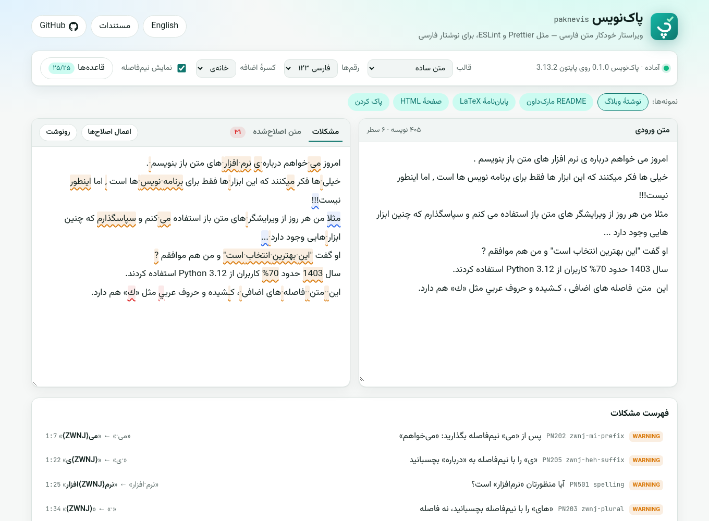

<div align="center">


# پاک‌نویس · paknevis

**ویراستار خودکار متن فارسی — Persian text linter & auto-fixer**

Prettier/ESLint for Persian writing: ZWNJ, Arabic characters, punctuation, digits and common misspellings —
safe for Markdown, HTML and LaTeX (XePersian).

[](https://github.com/mrzroot/paknevis/actions/workflows/ci.yml)
[](LICENSE)
[](pyproject.toml)
[](https://mrzroot.github.io/paknevis/)

[**🧪 Playground**](https://mrzroot.github.io/paknevis/) · [فارسی](#فارسی) · [English](#english) · [Rules](#rules--قاعدهها) · [Changelog](CHANGELOG.md)

<a href="https://mrzroot.github.io/paknevis/"></a>

</div>

---

<div dir="rtl">

## فارسی

**پاک‌نویس** متن فارسی را مثل یک ویراستار دقیق بررسی می‌کند و هر جا اصلاح بی‌خطر باشد، آن را خودکار درست می‌کند: نیم‌فاصله‌ها، حروف عربی، نشانه‌گذاری، رقم‌ها، فاصله‌ها و غلط‌های املایی رایج. برای برنامه‌نویس‌ها، نویسنده‌ها، دانشجوها (به‌ویژه پایان‌نامه‌های LaTeX با XePersian) و تیم‌های مستندسازی ساخته شده است.

### چرا پاک‌نویس؟

- **به کد دست نمی‌زند.** بلوک‌ها و تکه‌های کد، نشانی‌های وب، ایمیل، برچسب‌های HTML، فرانت‌متر مارک‌داون، فرمول‌ها و دستورهای LaTeX هرگز تغییر نمی‌کنند.
- **هوشمند و محافظه‌کار.** قاعده‌ها فقط در بافت فارسی عمل می‌کنند؛ مثلاً «Python 3.12» و «10GB» دست نمی‌خورند، و «میز»، «میوه» و «میدان» با فعل‌های «می» اشتباه گرفته نمی‌شوند.
- **قابل‌پیکربندی.** هر قاعده شناسه، شدت، توضیح فارسی و انگلیسی دارد و می‌توانید خاموشش کنید.
- **همه‌جا.** کتابخانهٔ پایتون، خط فرمان، هوک pre-commit، GitHub Action و [محیط آزمایشی در مرورگر](https://mrzroot.github.io/paknevis/).
- **ایمن برای تکرار.** اجرای دوباره هیچ تغییری ایجاد نمی‌کند؛ این ویژگی با آزمون‌های ویژگی‌محور (Hypothesis) سنجیده می‌شود.

### پیش و پس از پاک‌نویس

```text
پیش:  امروز مي خواهم درباره ي نرم افزار هاي متن باز بنويسم , اما وقت ندارم ...
پس:   امروز می‌خواهم درباره‌ی نرم‌افزارهای متن باز بنویسم، اما وقت ندارم…

پیش:  او گفت "سلام" و رفت ?   این کتاب( که دیروز خریدم )عالی است.
پس:   او گفت «سلام» و رفت؟ این کتاب (که دیروز خریدم) عالی است.

پیش:  سال 1403 حدود 50% کاربران از Python 3.12 استفاده کردند.
پس:   سال ۱۴۰۳ حدود ۵۰٪ کاربران از Python 3.12 استفاده کردند.
```

### نصب

پاک‌نویس هنوز در PyPI منتشر نشده است؛ از گیت‌هاب نصبش کنید:

```bash
pip install "paknevis @ git+https://github.com/mrzroot/paknevis@v0.1.0"
# پشتیبانی از Word:
pip install "paknevis[docx] @ git+https://github.com/mrzroot/paknevis@v0.1.0"
```

### استفاده در خط فرمان

```bash
paknevis check docs/                 # گزارش مشکلات
paknevis check --lang fa thesis.tex  # پیام‌ها به فارسی
paknevis fix --diff README.md        # پیش‌نمایش اصلاح‌ها
paknevis fix .                       # اصلاح همهٔ پرونده‌ها
paknevis explain zwnj-plural         # توضیح یک قاعده
```

### در پایتون

```python
import paknevis

paknevis.fix("كتاب هاي من")  # 'کتاب‌های من'
paknevis.fix(text, syntax="latex")  # آگاه از LaTeX
for d in paknevis.lint("علي مي رود"):
    print(d.line, d.column, d.rule, d.message_fa)
```

### پایان‌نامه‌های LaTeX

پاک‌نویس برای پایان‌نامه‌های XePersian طراحی شده است: متن درون `\section` و `\caption` و `\footnote` و `\textbf` بررسی می‌شود، اما فرمول‌ها، `\cite` و `\ref` و `\label`، محیط‌های `equation` و `verbatim`، و متن لاتین درون `\lr{…}` یا محیط `latin` دست نمی‌خورند. دستورهای قالب خودتان را با گزینهٔ `latex-text-commands` معرفی کنید.

### غیرفعال کردن موضعی

```markdown
<!-- paknevis-disable -->
این بخش بررسی نمی‌شود.
<!-- paknevis-enable -->
```

در LaTeX از `% paknevis-disable-next-line` و در متن ساده از `# paknevis-disable-line` استفاده کنید.

</div>

---

## English

**paknevis** (Persian *پاک‌نویس*, “clean copy”) is a linter and auto-fixer for Persian text — think Prettier/ESLint for Persian writing. It fixes ZWNJ (half-space) usage, Arabic characters and digits, punctuation and spacing, quotes, kashida and a curated list of common misspellings, while never touching code, URLs, markup or math.

### Highlights

- **Format-aware.** Plain text, Markdown, HTML and LaTeX (with XePersian awareness). Code spans/blocks, URLs, e-mails, HTML tags and attributes, front matter, math, LaTeX commands and `\lr{…}` Latin text are protected. Optional `.docx` support preserves run formatting.
- **Conservative by design.** Rules act only in Persian context: `Python 3.12`, `10GB` or `apple, orange` are left alone; joined «می» verbs are fixed only for a curated list of verb stems so nouns like «میز» or «میدان» are safe.
- **25 rules**, each with an id (`PN203`) and a name (`zwnj-plural`), severity, bilingual explanation, examples and (where safe) an autofix. Every rule can be disabled.
- **Idempotent.** `fix(fix(x)) == fix(x)`, verified with property-based tests along with “protected regions never change”.
- **Everywhere:** Python API, CLI with CI-friendly exit codes, JSON and GitHub-annotation output, pre-commit hook, GitHub Action and a [browser playground](https://mrzroot.github.io/paknevis/) that runs the real package via Pyodide.

### Install

paknevis is not published on PyPI yet; install it from GitHub:

```bash
pip install "paknevis @ git+https://github.com/mrzroot/paknevis@v0.1.0"
pip install "paknevis[docx] @ git+https://github.com/mrzroot/paknevis@v0.1.0"   # + .docx support
```

Wheels and sdists are also attached to each [GitHub release](https://github.com/mrzroot/paknevis/releases).

### Before / after

```text
before: امروز مي خواهم درباره ي نرم افزار هاي متن باز بنويسم , اما وقت ندارم ...
after:  امروز می‌خواهم درباره‌ی نرم‌افزارهای متن باز بنویسم، اما وقت ندارم…

before: \section{بيان مسئله} در این پژوهش , روش های جدید را بررسی می کنیم \cite{goodfellow2016}.
after:  \section{بیان مسئله} در این پژوهش، روش‌های جدید را بررسی می‌کنیم \cite{goodfellow2016}.
```

### Command line

```console
$ paknevis check docs/
docs/intro.md:3:12: warning PN301 [persian-comma] Use the Persian comma «،»  «,» → «،»
docs/intro.md:5:1: warning PN202 [zwnj-mi-prefix] Use a ZWNJ after «می»: «می‌روم»  «می·» → «می⟨ZWNJ⟩»
Found 2 issues in 4 files (2 fixable with `paknevis fix`).

$ paknevis fix --check .      # CI: exit 1 if any file would change
$ paknevis fix --diff thesis.tex
$ paknevis fix .              # rewrite files in place
$ cat notes.txt | paknevis fix -   # stdin → stdout
```

| Command | What it does |
|---|---|
| `paknevis check PATHS…` | Report problems. `--format text\|concise\|json\|github`, `--diff`, `--statistics`, `--fail-on info\|warning\|error`, `--lang fa` |
| `paknevis fix PATHS…` | Fix in place. `--check` (exit 1 if changes are needed), `--diff` (print, don't write), `-` for stdin |
| `paknevis rules` | List rules (`--format json\|markdown`) |
| `paknevis explain RULE` | Explain a rule in English and Persian, with examples |

Shared options: `--syntax plain|markdown|html|latex`, `--disable RULES`, `--enable RULES`, `--exclude GLOB`, `--digits persian|latin|keep`, `--ezafe zwnj|hamza`, `--teh-marbuta warn|heh|teh`, `--config FILE`, `--isolated`. Paths may be files, directories (`.md .markdown .mdx .txt .html .htm .tex`) or globs; `.git`, `node_modules`, virtualenvs and build folders are skipped. `.docx` files are processed when passed explicitly.

**Exit codes:** `0` clean · `1` issues found / files would change · `2` usage, config or I/O error.

### Python API

```python
import paknevis

paknevis.fix("كتاب هاي من")  # 'کتاب‌های من'
paknevis.fix(md_text, syntax="markdown")  # code, links, HTML untouched
paknevis.fix(text, digits="latin", disable=["kashida"])

for d in paknevis.lint("علي مي رود", syntax="plain"):
    print(d.code, d.rule, d.severity.value, d.line, d.column, d.message, d.replacement)

from paknevis import Config, Linter, load_config

linter = Linter(load_config())  # pyproject.toml / .paknevis.toml
result = linter.fix_with_report(text, syntax="latex")
result.text, result.diagnostics, result.remaining
```

`Diagnostic` offsets are code-point offsets, so `text[d.offset:d.end_offset] == d.original`.

### Configuration

In `pyproject.toml` (or a `.paknevis.toml` without the `[tool.paknevis]` header):

```toml
[tool.paknevis]
disable = ["kashida", "tanvin"]      # names or codes (PN403)
digits = "persian"                   # persian | latin | keep
ezafe = "zwnj"                       # zwnj (خانه‌ی) | hamza (خانهٔ)
teh-marbuta = "warn"                 # warn | heh | teh
fail-on = "warning"                  # info | warning | error
exclude = ["vendor/**"]              # replaces the default excludes
extend-exclude = ["CHANGELOG.md"]
latex-text-commands = ["faTitle", "abstractFa"]   # custom macros whose {…} is Persian prose
dictionaries = ["docs/words.yaml"]   # extra spelling dictionaries

[tool.paknevis.severity]
spelling = "error"

[tool.paknevis.spelling]
"وب سرویس" = "وب‌سرویس"
```

Inline directives work in any comment syntax: `<!-- paknevis-disable -->` … `<!-- paknevis-enable -->`, `% paknevis-disable-next-line`, `# paknevis-disable-line`.

### pre-commit

```yaml
repos:
  - repo: https://github.com/mrzroot/paknevis
    rev: v0.1.0
    hooks:
      - id: paknevis          # fixes files
      # - id: paknevis-check  # report only
```

### GitHub Action

```yaml
- uses: actions/checkout@v4
- uses: mrzroot/paknevis@v0.1.0
  with:
    paths: docs/ README.md
    # command: check        # or "fix"
    # args: --fail-on error
```

Problems show up as inline annotations on the pull request.

### Playground

<https://mrzroot.github.io/paknevis/> — paste Persian text and see highlighted issues and the fixed output live. It lazily loads [Pyodide](https://pyodide.org) and runs **the actual Python package** (bundled from `src/` and checked in CI to be up to date), so the playground and the CLI always agree. Nothing is uploaded anywhere.

---

## Rules · قاعده‌ها

<!-- paknevis-disable (the table shows incorrect examples on purpose) -->

| Code | Name | قاعده | Rule | Severity | Autofix |
|---|---|---|---|---|:-:|
| PN101 | `arabic-yeh` | «ي» عربی به‌جای «ی» فارسی | Arabic Yeh / Alef Maksura → «ی» | error | ✅ |
| PN102 | `arabic-kaf` | «ك» عربی به‌جای «ک» فارسی | Arabic Kaf → «ک» | error | ✅ |
| PN103 | `non-persian-heh` | گونهٔ غیرفارسی «ه» | Urdu/Kurdish Heh variants → «ه» | error | ✅ |
| PN104 | `arabic-teh-marbuta` | «ة» (تای گرد) عربی | Teh Marbuta (report, or fix to «ه»/«ت») | info | ⚙️ opt-in |
| PN105 | `arabic-digits` | رقم‌های عربی | Arabic-Indic digits → configured style | error | ✅ |
| PN106 | `digit-style` | سبک رقم‌ها | Latin ↔ Persian digits in Persian context | warning | ✅ |
| PN201 | `zwnj-cleanup` | نیم‌فاصلهٔ زائد یا تکراری | Duplicate / misplaced ZWNJ | warning | ✅ |
| PN202 | `zwnj-mi-prefix` | نیم‌فاصله پس از «می» و «نمی» | «می روم»، «میروم» → «می‌روم» | warning | ✅ |
| PN203 | `zwnj-plural` | نیم‌فاصله پیش از «ها»ی جمع | «کتاب ها» → «کتاب‌ها» | warning | ✅ |
| PN204 | `zwnj-comparative` | نیم‌فاصله پیش از «تر» و «ترین» | «بزرگ ترین» → «بزرگ‌ترین» | warning | ✅ |
| PN205 | `zwnj-heh-suffix` | پسوندهای پس از «ه» ناملفوظ | «خانه ای»، «رفته اند»، «نامه ی» | warning | ✅ |
| PN301 | `persian-comma` | ویرگول فارسی | `,` → «،» after Persian words | warning | ✅ |
| PN302 | `persian-semicolon` | نقطه‌ویرگول فارسی | `;` → «؛» | warning | ✅ |
| PN303 | `persian-question-mark` | علامت سؤال فارسی | `?` → «؟» | warning | ✅ |
| PN304 | `space-before-punctuation` | فاصله پیش از نشانه‌ها | No space before «، ؛ ؟ . : !» | warning | ✅ |
| PN305 | `space-after-punctuation` | نبود فاصله پس از نشانه‌ها | One space after punctuation | warning | ✅ |
| PN306 | `bracket-spacing` | فاصله‌گذاری کمانک و گیومه | Spacing around ( ) and « » | warning | ✅ |
| PN307 | `persian-quotes` | گیومهٔ فارسی | `"…"` / `“…”` → «…» | warning | ✅ |
| PN308 | `ellipsis` | نویسهٔ سه‌نقطه | `...` → «…» | info | ✅ |
| PN309 | `repeated-punctuation` | نشانه‌های تکراری | «؟؟؟» → «؟» | info | ✅ |
| PN401 | `multiple-spaces` | فاصله‌های پشت‌سرهم | Collapse repeated spaces | warning | ✅ |
| PN402 | `trailing-whitespace` | فاصلهٔ پایان سطر | Trailing whitespace (keeps Markdown hard breaks) | warning | ✅ |
| PN403 | `kashida` | کشیده (ـ) | Remove kashida/tatweel | warning | ✅ |
| PN501 | `spelling` | غلط املایی رایج | Curated, extensible YAML dictionary | warning | ✅ |
| PN502 | `tanvin` | تنوین قید | «لطفا» → «لطفاً» | info | ✅ |

<!-- paknevis-enable -->

Run `paknevis explain <rule>` for the full bilingual explanation and examples.

### What is protected?

| Syntax | Never modified |
|---|---|
| all | URLs, e-mail addresses, `paknevis-disable` regions |
| Plain text | `` `inline code` `` |
| Markdown | front matter (`---`/`+++`), fenced & indented code, inline code, link/image destinations and titles, reference definitions, autolinks, raw HTML tags/comments, `$math$`/`$$math$$`, ordered-list numbers, footnote labels, `{#attrs}`, `:emoji:`, `{{ templates }}` |
| HTML | tags and attributes, comments, entities, `<pre> <code> <script> <style> <textarea> <kbd> <samp> <math> <svg>` |
| LaTeX | commands and their options/arguments (except prose arguments of `\section`, `\caption`, `\footnote`, `\textbf`, `\emph`, …), comments, `$…$`, `\(…\)`, `\[…\]`, math/verbatim/listing/TikZ environments, XePersian `\lr{…}`, `\latin{…}` and `latin`/`LTR` environments, `\verb` |

### Limitations

paknevis is rule-based, not a full morphological analyser. ZWNJ heuristics use curated word lists and context checks to avoid false positives, so some valid fixes are intentionally skipped. If you hit a false positive, please [open an issue](https://github.com/mrzroot/paknevis/issues/new/choose) with the sentence.

## Contributing

Contributions are very welcome — especially new rules, dictionary entries and false-positive reports. See [CONTRIBUTING.md](CONTRIBUTING.md) (it includes a step-by-step guide to adding a rule) and [SECURITY.md](SECURITY.md).

## License

[MIT](LICENSE) © 2026 Mohammadreza Zare. The playground self-hosts the [Vazirmatn](https://github.com/rastikerdar/vazirmatn) font (SIL Open Font License 1.1).
